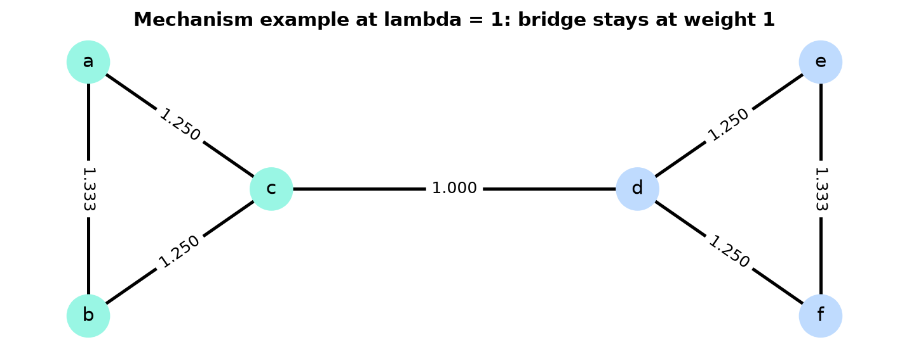
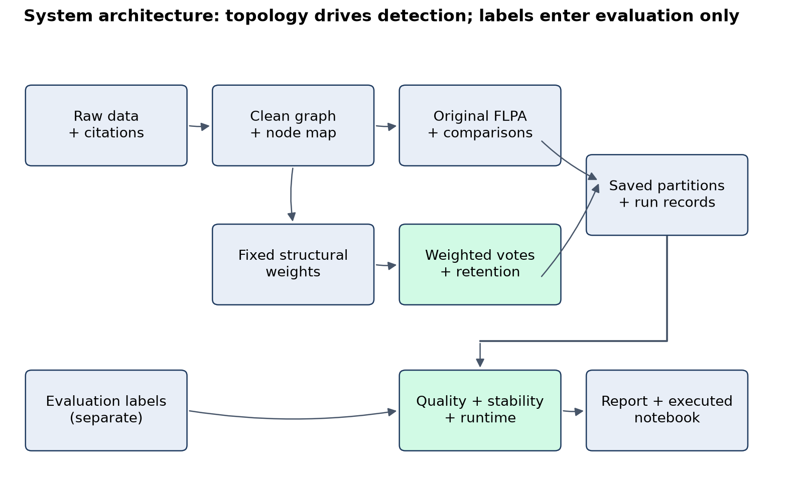
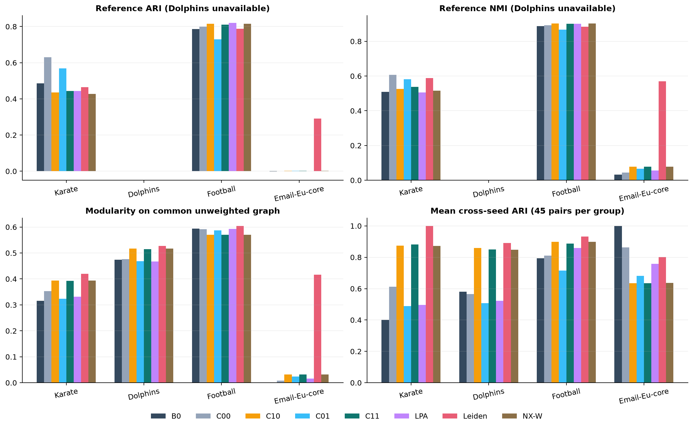
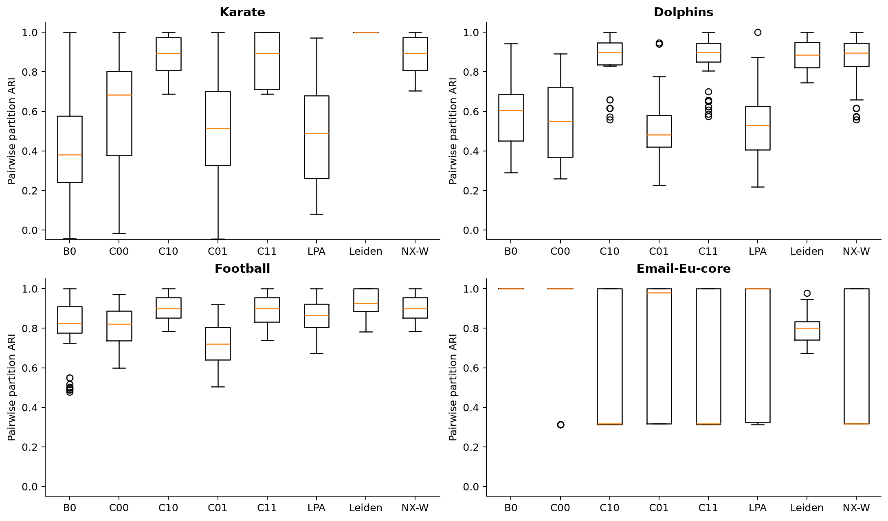
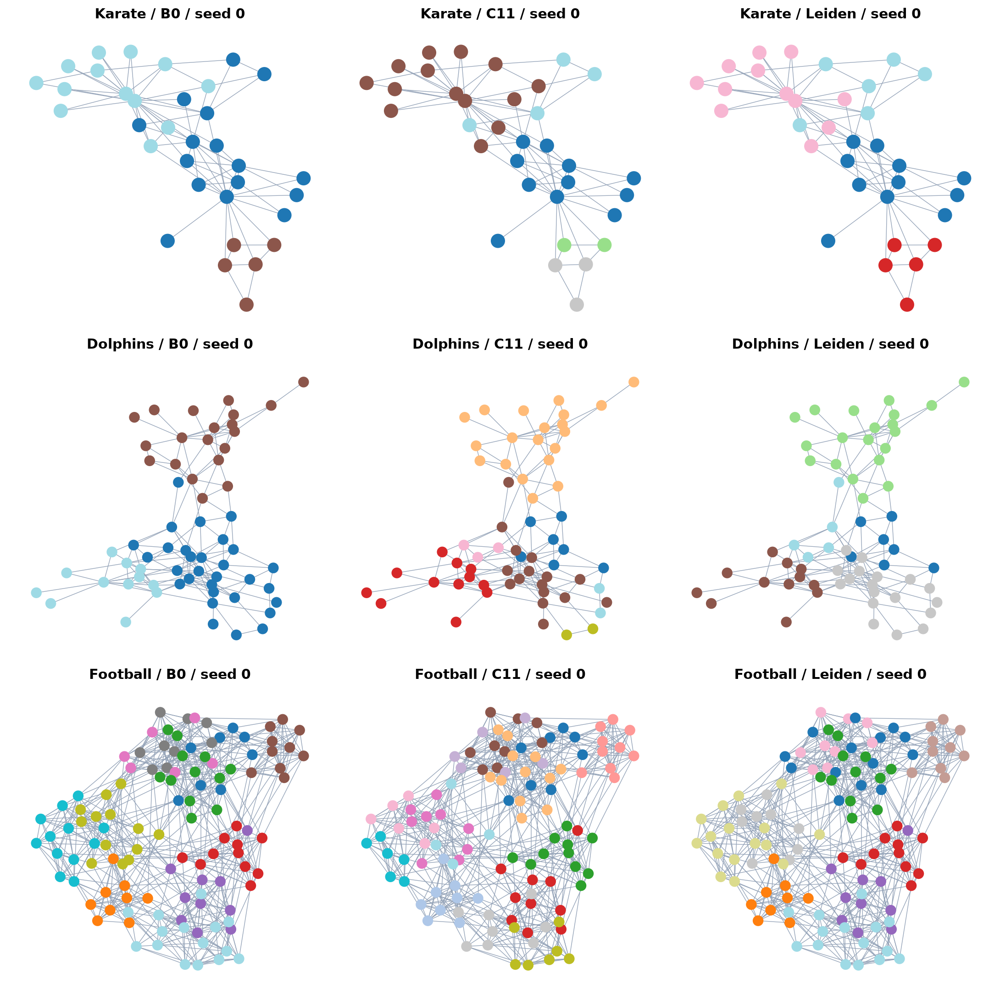
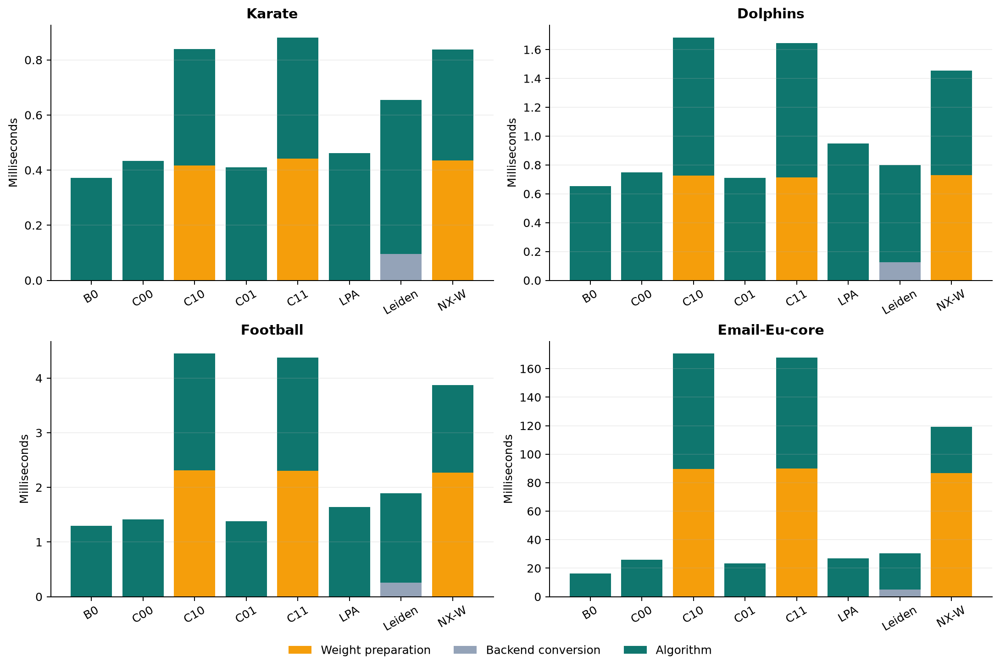
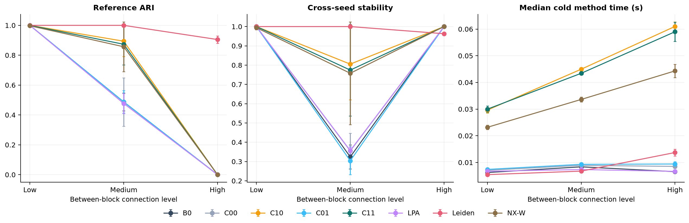

# Abstract

Community detection reveals groups of densely connected entities, but fast label propagation can produce inconsistent or trivial partitions. This project independently implements the original queue algorithm and evaluates fixed Jaccard structural weights with maximal-label retention. A separate synthetic development set selects the weighting parameter without consulting final benchmark labels. Eight configurations are evaluated over ten seeds on four real networks and nine synthetic graphs, producing 1040 final runs. Controlled ablations distinguish weighting, retention and scheduling effects. Weighting improves repeatability on several small networks, while reference agreement and modularity show dataset-dependent tradeoffs. On the email network, propagation variants still form an unhelpful giant community; under high synthetic mixing they collapse despite perfect repeatability. Leiden remains a stronger comparison in these difficult settings. The results support a reproducible study of quality, stability and computational cost rather than universal superiority or an unverified claim of algorithmic novelty. Reproducible artifacts accompany every measured conclusion.

<!-- toc -->

<!-- pagebreak -->

# 1. Introduction and objectives

Social network analysis represents entities as nodes and relationships as edges. A friendship network, an association network among animals, an inter-team game schedule and an organisational email network all encode interactions through this representation. Community detection seeks a useful grouping of those nodes. A common intuition is that members of a group connect more strongly to each other than to the rest of the network. However, metadata groups, a modularity optimum and a locally stable label partition can disagree. This makes careful evaluation necessary: a visually attractive network drawing or a high value of one metric cannot establish that the result answers the intended question.

Label propagation is appealing because it requires neither a preset number of groups nor supervised training labels. Each node begins with an individual label and repeatedly adopts a label supported by its neighbours. The original asynchronous method is a foundational comparison [R11]. Traag and Subelj's Fast Label Propagation (FLPA) uses an explicit work queue so that label changes trigger consideration of affected neighbours [R01]. This reduces unnecessary scans while retaining a local maximal-support condition at normal termination. Our base paper is exactly this Scientific Reports article, not another overlapping-community algorithm that happens to use the acronym FLPA.

Two limitations motivate our investigation. First, treating all connections equally ignores local structural evidence. An edge embedded in a triangle may convey different information from a bridge between two regions. Second, random choices among tied labels and the sequence of updates can affect the result. The recovered project proposal combines a fixed structural weight derived from shared neighbours with retention of an already maximal current label. These are established ideas, so the implementation and report distinguish a tested engineering combination from a claim to have invented weighted propagation, Jaccard similarity or retention.

Our purpose is to investigate the complete quality-stability-cost tradeoff. Repeatability means that different random seeds produce similar partitions; it is useful for reproducibility, but a constant incorrect answer is also repeatable. Reference agreement asks whether discovered communities resemble club factions, conferences or departments. Modularity measures structure relative to a null model, but does not require agreement with those metadata. Runtime asks whether any practical benefit justifies additional preparation work. We therefore measure all of these quantities and keep community-size diagnostics alongside them.

The implementation separates graph preparation, detection, experimental control, evaluation and presentation. Every method receives the same processed topology, while reference labels are isolated from the algorithms. We first reproduce the unchanged baseline, test it against NetworkX, then implement independently controlled weighting and retention options. Two identifiable existing comparison works are asynchronous LPA [R11] and Leiden [R12]. An additional NetworkX weighted-FLPA reference makes clear that weight support is already available. We use separate synthetic development graphs for parameter selection, four real networks and nine final synthetic graphs for evaluation.

The research questions are: RQ1, does the specified design improve agreement across seeds? RQ2, does it preserve useful community structure? RQ3, what preparation and execution cost does it introduce? RQ4, which component explains the measured changes? RQ5, under which structural conditions does it fail? Successful completion means answering those questions with traceable evidence, including unfavourable findings. It does not require the extension to dominate every comparison method. This report consequently presents an independent reproduction and controlled empirical extension rather than numerical replication of the base paper's very large-network experiments.

## 1.1 Base-paper and team contributions

The base paper contributes a queue-driven propagation rule, an analysis of local label maximality, and theoretical/empirical comparisons of propagation approaches, including large networks [R01]. Our reproduced scope is the core simple-undirected, unweighted update rule and its stopping behaviour. The source implementation and benchmark sizes used here differ from the paper's full experimental setup.

Our implemented contributions are (1) a configurable topology-derived weighting and maximal-label-retention extension with a separately controlled scheduler; and (2) a reproducible empirical pipeline with development-only selection, eight configurations, multi-seed analysis, failure accounting and independently auditable outputs. The literature does not establish global originality of the combination, and no such originality is claimed. All numerical results below were obtained by executing the submitted code.

# 2. Literature review: ten recent journal papers

Ten journal research articles published from 2022 onward were verified using publisher pages, DOI metadata and the downloaded full texts. Full PDFs, extracted text and bibliographic evidence are included under research/. The review is focused on propagation, structural weighting, alternative community principles and uncertainty across partitions. The articles below are reviewed literature, not ten reproduced algorithms. Their results use different datasets and protocols and are not merged into our measured result tables.

## 2.1 Large network community detection by fast label propagation (2023) [R01]

**Method and setting.** Queue-based asynchronous label propagation revisits nodes affected by label changes, with a local maximal-support condition at normal termination. Synthetic benchmark families and empirical networks, including Karate, Dolphins and Football.

**Evidence and metrics.** The authors report substantial speed benefits over repeated full scans. Our study reproduces the core update rule, not their largest-scale numerical speed claims. Metrics: Partition quality and runtime; local support guarantee. Source locations: Algorithm 3; retention subsection; Results and empirical-network methods.

**Assessment.** Simple queue bookkeeping reduces redundant visits. Limitation: Local label maximality does not guarantee useful or globally optimal communities. Relevance: Exact base method; already discusses retention, so retention is not an invented mechanism.

## 2.2 A community partitioning algorithm for cyberspace (2023) [R02]

**Method and setting.** PR-LFM selects high-degree seeds, expands local-fitness communities, then uses PageRank to resolve overlapping assignments. Classic social graphs and router-network examples; inspect the source-specific versions before reproduction.

**Evidence and metrics.** The paper reports competitive community division with a local-expansion pipeline. Its router experiments do not establish performance on our prepared benchmark versions. Metrics: NMI, modularity Q and runtime. Source locations: Methods, Eq. 7; Tables 2-5 and Figure 6.

**Assessment.** Makes seed selection and overlap resolution explicit. Limitation: Resolution choices and router-data access complicate like-for-like reproduction. Relevance: A related local community method; our project keeps disjoint FLPA propagation rather than adopting PR-LFM.

## 2.3 Iterative embedding and reweighting of complex networks reveals community structure (2024) [R03]

**Method and setting.** Iterative embedding and reweighting alternates graph embeddings with geometry-derived edge-weight updates to separate communities. Planted-partition and LFR synthetic networks, with additional network examples.

**Evidence and metrics.** The authors show that reweighting can help conventional detectors recover planted structure. Weight interpretation depends on whether the embedding yields distances or proximities. Metrics: Element-centric similarity, NMI, detected community count and geometric separation. Source locations: Results; Figures 3-6; Methods and supplementary sensitivity discussions.

**Assessment.** Separates a reusable graph transformation from downstream community detection. Limitation: Repeated embeddings cost more and introduce settings absent from our local feature rule. Relevance: Important reweighting prior art; our weights are computed once from local neighbourhood overlap.

## 2.4 GATFELPA integrates graph attention networks and enhanced label propagation for robust community detection (2025) [R04]

**Method and setting.** GATFELPA combines graph attention, enhanced label propagation, adaptive aggregation depth and a similarity-preservation mechanism. Cora, CiteSeer, PubMed and ogbn-arxiv attributed citation networks.

**Evidence and metrics.** The article reports favourable performance across its attributed-graph experiments. Those training and input conditions differ from topology-only FLPA. Metrics: Community/clustering agreement, robustness and computational comparisons in the paper's own setup. Source locations: Similarity preservation; Experimental analysis; ablation and parameter sections.

**Assessment.** Uses learned representations and local/global similarity information. Limitation: Model training, attributes and multiple components prevent a fair direct comparison without matching their protocol. Relevance: Shows that similarity-guided propagation is established; we do not claim to reproduce this neural model.

## 2.5 Graph embedding based label propagation for community detection in social networks (2025) [R05]

**Method and setting.** Embedding-based label propagation uses embedding similarities to weight neighbourhood label updates, mixing local connectivity with global representation. Social-network benchmarks including Karate, Dolphins and Polbooks, plus LFR synthetic cases.

**Evidence and metrics.** Reported tables compare the embedding-guided rule with other detectors. The paper's favourable findings are not a guarantee that our fixed local weighting will generalise. Metrics: Modularity, community counts and partition-agreement measures reported in the article. Source locations: Eq. 8; Algorithm 1; Tables 1-6 and LFR benchmark discussion.

**Assessment.** Allows nonlocal structural information to influence propagation. Limitation: Embedding choices add a separate cost and selection budget; exact dataset/protocol alignment remains necessary. Relevance: A close similarity-weighted propagation relative, with embeddings replacing our fixed Jaccard feature.

## 2.6 Community detection in networks by dynamical optimal transport formulation (2022) [R06]

**Method and setting.** ORC-Nextrout uses dynamical optimal transport and Ollivier-Ricci geometry to control information flow between neighbourhoods. SBM and LFR synthetic benchmarks and real networks with node metadata.

**Evidence and metrics.** The authors show that transport settings change which structures can be recovered, with gains in parts of the tested regimes. Metrics: Adjusted Rand Index and comparisons across transport regimes. Source locations: Results on community detection problems; Figures 3 and 5; Table 1.

**Assessment.** Provides a geometric interpretation of intra-community edges and bottlenecks. Limitation: Transport parameters and optimisation cost differ from lightweight propagation; best-setting results require attention to selection rules. Relevance: Motivates sensitivity to structural regimes and explicit parameter selection, not a direct implemented comparator.

## 2.7 Representative community divisions of networks (2022) [R07]

**Method and setting.** Clusters an ensemble of candidate network partitions into representative modes using an information-theoretic description of the solution set. Synthetic and empirical partition ensembles generated for the same underlying networks.

**Evidence and metrics.** The study explains why several plausible partitions can coexist and why a single optimum may hide important variation. Metrics: Representativeness, partition description and diversity of competing community divisions. Source locations: Results and discussion; Figure 1; mode-finding and partition-transmission formulation.

**Assessment.** Treats variability as information to inspect rather than automatically as an error. Limitation: Requires an ensemble and answers a different question from producing a single propagation partition. Relevance: Supports our multi-seed analysis and caution that repeatability alone is not correctness.

## 2.8 Network community detection via neural embeddings (2024) [R08]

**Method and setting.** Analyses neural embeddings for community recovery, combining theoretical planted-model results with embedding and clustering experiments. Planted-partition/SBM, LFR and empirical networks including Football.

**Evidence and metrics.** Certain shallow embedding methods can approach detectability limits under stated model assumptions, while sparse and unequal-community cases show important differences. Metrics: Partition recovery and element-centric similarity across mixing and degree regimes. Source locations: Figures 1-3; Simulations: LFR benchmark; theoretical assumptions in Methods.

**Assessment.** Connects practical representation methods to an explicit recovery framework. Limitation: Theoretical claims depend on model assumptions and do not certify arbitrary real networks or all embeddings. Relevance: Motivates varying synthetic between-community connectivity and keeping global-representation claims outside our local method.

## 2.9 Local dominance unveils clusters in networks (2024) [R09]

**Method and setting.** Local Search derives community centres and hierarchies from local dominance relationships between nodes rather than iterative modularity optimisation. Synthetic and empirical networks with reference labels, plus networks constructed from vector data.

**Evidence and metrics.** The reported experiments show that local dominance captures structure that can differ from a modularity partition. Metrics: Recovery quality, hierarchical structure, robustness and computational behaviour. Source locations: Figures 1-3; Results; Methods and supplementary benchmark descriptions.

**Assessment.** Uses a distinct local structural principle with interpretable centres. Limitation: Community-centre interpretation is a different objective, so matching modularity alone is insufficient for judging it. Relevance: Reinforces use of multiple metrics and the distinction between local structure and a global objective.

## 2.10 Betweenness-driven overlapping label propagation community detection (2025) [R10]

**Method and setting.** BD-LPA uses degree/betweenness-guided overlapping label propagation with pruning and refinement mechanisms. Karate, Polbooks, Football and twelve LFR synthetic datasets.

**Evidence and metrics.** The authors report favourable overlapping-community results with configuration-dependent behaviour. This is a multi-membership problem, unlike our disjoint partitions. Metrics: Overlapping NMI, omega index, generalised F1, modularity and extended variation measures. Source locations: Section 3; Tables 1-6; pruning and refinement descriptions.

**Assessment.** Makes node importance and stability-related pruning explicit. Limitation: Overlapping metrics and tuning choices cannot be imported directly into a disjoint FLPA evaluation. Relevance: Recent propagation/stability prior art; demonstrates that importance weighting and pruning are established directions.

## 2.11 Synthesis and distinction from existing work

Recent work already uses importance, similarity and representation learning to guide community formation. The closest conceptual relatives are similarity-weighted propagation [R05], graph reweighting [R03] and stability/pruning variants [R10], while the base article itself discusses retention [R01]. Ensemble analysis [R07] also cautions against interpreting one partition as the only plausible answer. Our narrow distinction is the specified fixed local Jaccard weight, an explicit retention switch, and controlled measurement of its interaction with scheduling. Unlike embedding or attention models, it requires no trained representation. Unlike an overlapping detector, it assigns one group per node. The evidence must still demonstrate when this lightweight design helps, rather than assuming it will.

# 3. Methodology and algorithm design

## 3.1 Graph assumptions and original FLPA

The supported graph is simple, undirected and loop-free, with all source nodes retained. Internal node IDs are deterministic integers; original IDs/names remain in a mapping file. Initial labels are unique per node. Unit support is the number of neighbours holding a candidate label. Original FLPA samples uniformly among labels with maximal unit support, updates immediately, and queues neighbours whose labels differ from the new label if they are not already queued. An isolate keeps its initial label. The queue starts with all nodes in a seeded random order. The original tie rule resamples even if the current label is maximal.

```text
support(u, c) = sum_{v in N(u)} indicator(label(v) == c)
Q = all nodes in seeded random order; in_queue = set(Q)
while Q is not empty:
    pop u; remove u from in_queue
    if u is isolated: continue
    sample a maximal-support label c_new
    if c_new differs from label(u):
        assign c_new immediately
        enqueue each neighbour v with label(v) != c_new
        unless v is already queued
```

## 3.2 Static structural weights

For each existing edge, use full open-neighbour sets, excluding each node from its own set but not removing the opposite endpoint before the union. Similarity and weight are:

```text
common(u,v) = |N(u) intersection N(v)|
J(u,v) = common(u,v) / (degree(u) + degree(v) - common(u,v))
w(u,v) = 1 + lambda * J(u,v),  lambda >= 0
weighted_support(u,c) = sum_{v in N(u)} w(u,v) * indicator(label(v)==c)
```

The frozen lambda selected on development graphs is **0.25**. Weights are fixed during a run, positive and symmetric. Topology remains unchanged, and source interaction weights are not used. Similarities are calculated only for existing edges using neighbour sets; no dense node-by-node matrix is created. At lambda zero, every structural weight equals one.



## 3.3 Retention, tolerances and queue controls

The retain-maximal policy keeps the current label when it lies among maximal weighted candidates; otherwise it samples among maximal candidates. A floating score is tied when best minus score is at most atol + rtol * abs(best), with atol = rtol = 1e-12. Unweighted counts use exact comparisons. Stable neighbour iteration and a local seeded generator make runs reproducible. Deep-copying a weighted graph preserves adjacency order, because rebuilding that order can change an asynchronous queue trajectory.

During initial modification we use the conservative policy of queuing all neighbours of a changed node. Extra visits can change random tie resampling and execution cost. We therefore isolate this scheduler from the effects of weights and retention. The four Cxx ablations share the same conservative scheduler; B0 retains the original filtered queue.

| ID | Votes | Tie rule | Queue |
| --- | --- | --- | --- |
| B0 | Unit | Random maximal | Original filtered |
| C00 | Unit | Random maximal | All changed neighbours |
| C10 | Structural | Random maximal | All changed neighbours |
| C01 | Unit | Retain maximal | All changed neighbours |
| C11 | Structural | Retain maximal | All changed neighbours |
| LPA | Unit | Asynchronous LPA [R11] | Library |
| Leiden | Unit | Modularity objective [R12] | Library |
| NX-W | Structural | NetworkX weighted FLPA | Original filtered |

C00-B0 isolates scheduling; C10-C00 isolates weighting without retention; C01-C00 isolates retention without weighting; C11-C01 isolates weighting with retention. C11-B0 compares the complete design and must not be attributed to weights alone. Lambda-zero C10/C00 and C11/C01 agree under aligned settings; lambda-zero C11 does not become B0 because ties and queues still differ.

## 3.4 Stopping, correctness and computational cost

Instrumented propagation has a safety cap of max(10000, 1000*n) queue pops and a 120-second wall-time budget checked inside its loop. A cap-limited result would be retained and reported separately, not counted as converged. External library comparisons use their documented stopping policies; these in-loop caps do not pretend to interrupt an external library. Normal FLPA completion is independently checked for complete node coverage and maximal final support. This establishes a local condition, not a globally optimal community partition.

Neighbour-set preparation uses memory proportional to the sparse graph representation. A direct common-neighbour intersection has an approximate work cost proportional to the sum over edges of min(degree(u), degree(v)); algorithm execution also depends on queue revisits. We make no universal linear-time claim for the entire modified system. Cold timing includes actual weight computation and application, backend conversion where required, and algorithm execution. It excludes common graph loading, evaluation, plotting and result-file writes.

<!-- pagebreak -->

# 4. System design and implementation



| Module | Responsibility and connection |
| --- | --- |
| data.py | Retrieve sources, prepare topology, preserve node maps and separate labels; feed every algorithm the same graph. |
| algorithms.py | Original FLPA, structural features, controlled variants and comparison adapters; return assignments, counters and status. |
| contracts.py | Shared objects, canonical partitions, fingerprints and atomic JSON writes. |
| experiment.py | Select lambda on development graphs, schedule seeded runs, persist records and aggregate evidence. |
| evaluation.py | Check coverage, compute agreement/modularity/size metrics and pairwise partition stability. |
| figures.py | Generate plots and fixed-layout network drawings from saved results. |
| cli.py | Expose preparation, selection, execution, summary and plotting commands. |
| tools/ | Acquire literature; build/execute notebook; generate the report and package. |
| tests/ | Behavioural checks, exact reference parity, label alignment and data-integrity checks. |

The package is deliberately independent of the notebook. The notebook imports the submitted implementation, reruns live examples and independently recomputes all final saved metrics. A run folder contains the assignment CSV, a record JSON and diagnostics, while the attempt folder stores the frozen effective configuration, environment and expected-run manifest. Failures are preserved. Graph hashes include the full node universe, so isolates cannot disappear through an edge-list export.

<!-- pagebreak -->

# 5. Datasets and experimental setup

## 5.1 Real datasets and preprocessing

| Network | Nodes | Edges | Components | Isolates | Ref. groups |
| --- | --- | --- | --- | --- | --- |
| Karate club | 34 | 78 | 1 | 0 | 2 |
| Dolphins | 62 | 159 | 1 | 0 | Unavailable |
| Football | 115 | 613 | 1 | 0 | 12 |
| Email-Eu-core | 1005 | 16064 | 20 | 19 | 42 |

Karate is loaded from NetworkX, with its club attribute extracted for evaluation and its original edge weights disabled. Dolphins and Football come from Newman's original GML archives [D1]. The retrieved Football version has 613 edges, unlike the 616 reported by the FLPA paper; we use and identify the measured version rather than altering it to force agreement. Dolphins contains names but no verified two-group mapping in this source, so supervised agreement scores are unavailable. This limitation is disclosed throughout.

Email-Eu-core is retrieved from SNAP together with department labels [D2]. Its 25,571 source directed edges become 16,064 unique undirected non-self edges under OR-symmetrisation. Reciprocal pairs are deduplicated and source nodes retained. Departments are proxy reference groups rather than a unique definition of structural communities. The resulting graph includes isolated nodes, which are retained in all algorithms and scores. Every algorithm graph has no club, conference or department attribute; those mappings are used only by evaluation.

Source archives, raw checksums, original names/IDs, canonical edge lists and measured statistics are included. If an artifact is changed, loading verifies its graph hash and rejects inconsistent processed data.

## 5.2 Development and synthetic test design

Four development stochastic block model (SBM) graphs have four groups of 50 nodes, within-group probability 0.15, between-group probability 0.01 and generation seeds 100-103. Each lambda candidate (0, 0.25, 0.5, 1) is tested with algorithm seeds 0-4, for 80 development runs. Candidates must keep mean reference ARI within 0.02 of lambda zero and avoid a largest group exceeding 95% on these balanced examples. Select the highest mean stability; prefer a smaller lambda within 0.01. This rule was fixed before final evaluation.

The final synthetic study uses nine separate SBM graphs: four groups of 100 nodes, within-group probability 0.16, between-group probability 0.005/0.025/0.06 and generation seeds 200-202 at each level. This replaces the optional LFR stress design with a simpler fully specified planted experiment. Both generation seeds and algorithm seeds are saved and have separate roles. These are actual generated/analysed graphs; the measured outcomes below are not simulated results invented for a report.

| Lambda | Dev. ARI | Dev. stability | Largest fraction | Eligible |
| --- | --- | --- | --- | --- |
| 0 | 0.895 | 0.820 | 0.765 | True |
| 0.25 | 0.892 | 0.859 | 0.270 | True |
| 0.5 | 0.892 | 0.859 | 0.270 | True |
| 1 | 0.892 | 0.859 | 0.270 | True |

Lambda 0.25 is selected. The larger positive candidates produced the same development summary under this tested range, so the predeclared smaller-parameter tie rule applies. This does not establish universal parameter insensitivity. Final benchmark labels did not enter selection.

## 5.3 Software, configuration and metrics

The measured environment uses Python 3.12.15 on Windows-11-10.0.26300-SP0. Processor: Intel64 Family 6 Model 141 Stepping 1, GenuineIntel. Exact package versions and source fingerprints are stored with each attempt, and requirements-lock.txt captures the tested dependencies.

| Package | Version |
| --- | --- |
| networkx | 3.7 |
| numpy | 2.5.4 |
| scipy | 1.18.1 |
| pandas | 3.1.0 |
| scikit-learn | 1.9.1 |
| matplotlib | 3.11.2 |
| igraph | 1.0.0 |
| leidenalg | 0.12.0 |

Eight configurations, ten algorithm seeds (0-9), four real networks and nine final synthetic graphs yield 320 real and 720 synthetic runs. Jobs run sequentially with a separately seeded shuffled order (2718), with third-party imports warmed before measurement. Every expected attempt returned a complete partition and successful terminal status. Timing uses a single measured invocation for each method/seed: values on very small graphs are descriptive and can be dominated by overhead. Compiled Leiden and Python propagation costs include backend effects and should not be read as language-independent algorithmic speed claims.

ARI and arithmetic-normalised NMI compare partitions on an identical ordered node set; ARI can be negative and NMI is not chance adjusted. Modularity is evaluated for every method on the common original processed graph, unweighted, at resolution one. Community count, largest-group fraction and singleton fraction diagnose collapse or fragmentation. Cross-seed stability is the mean ARI of all 45 unordered pairs from ten outputs. Those pairs share runs and are dependent; no significance test treats them as independent samples. Quality tables give mean +/- sample standard deviation over ten algorithm seeds. Runtime tables report the median actual cold method total, with the full dispersion and component timings in the CSV outputs.

The LPA comparator explicitly disables source weights. Leiden uses leidenalg.ModularityVertexPartition, no source weights, standard modularity and n_iterations=-1, with a recorded seed and preserved node map. NX-W uses NetworkX FLPA with the same structural weights; it is a reference for an existing weighting capability, not a new comparison algorithm invented here.

# 6. Measured results on real networks

## 6.1 Karate club

| Method | ARI +/- SD | NMI +/- SD | Q +/- SD | Stability | Groups | Largest |
| --- | --- | --- | --- | --- | --- | --- |
| B0 | 0.486 +/- 0.285 | 0.509 +/- 0.219 | 0.316 +/- 0.100 | 0.400 | 2.5 | 0.588 |
| C00 | 0.630 +/- 0.227 | 0.608 +/- 0.179 | 0.353 +/- 0.081 | 0.612 | 2.4 | 0.559 |
| C10 | 0.435 +/- 0.067 | 0.526 +/- 0.058 | 0.393 +/- 0.010 | 0.874 | 5.1 | 0.388 |
| C01 | 0.568 +/- 0.293 | 0.581 +/- 0.227 | 0.324 +/- 0.113 | 0.489 | 3.0 | 0.579 |
| C11 | 0.444 +/- 0.079 | 0.537 +/- 0.063 | 0.393 +/- 0.011 | 0.881 | 5.1 | 0.397 |
| LPA | 0.444 +/- 0.265 | 0.505 +/- 0.205 | 0.332 +/- 0.111 | 0.495 | 3.7 | 0.518 |
| Leiden | 0.465 +/- 0.000 | 0.588 +/- 0.000 | 0.420 +/- 0.000 | 1.000 | 4.0 | 0.353 |
| NX-W | 0.427 +/- 0.062 | 0.516 +/- 0.052 | 0.393 +/- 0.010 | 0.872 | 5.1 | 0.385 |

C11 raises stability from 0.400 to 0.881 and modularity from 0.316 to 0.393, but reference ARI falls from 0.486 to 0.444. The extension finds about 5.1 groups rather than the two metadata factions. This is a stability/structural-quality versus metadata-agreement tradeoff, not an accuracy improvement. C00 also differs substantially from B0, confirming that scheduler effects matter.

## 6.2 Dolphins

| Method | ARI +/- SD | NMI +/- SD | Q +/- SD | Stability | Groups | Largest |
| --- | --- | --- | --- | --- | --- | --- |
| B0 | N/A | N/A | 0.474 +/- 0.061 | 0.580 | 4.2 | 0.434 |
| C00 | N/A | N/A | 0.476 +/- 0.061 | 0.566 | 4.4 | 0.411 |
| C10 | N/A | N/A | 0.517 +/- 0.024 | 0.858 | 4.4 | 0.352 |
| C01 | N/A | N/A | 0.468 +/- 0.042 | 0.507 | 6.0 | 0.394 |
| C11 | N/A | N/A | 0.514 +/- 0.021 | 0.850 | 5.8 | 0.350 |
| LPA | N/A | N/A | 0.467 +/- 0.053 | 0.522 | 5.0 | 0.410 |
| Leiden | N/A | N/A | 0.527 +/- 0.001 | 0.892 | 4.6 | 0.326 |
| NX-W | N/A | N/A | 0.517 +/- 0.024 | 0.848 | 4.5 | 0.353 |

C11 improves stability from 0.580 to 0.850 and modularity from 0.474 to 0.514. Leiden attains modularity 0.527. Without a verified reference partition, these are structural and repeatability findings only; they cannot establish improved recovery of the animals' two-group split.

## 6.3 Football

| Method | ARI +/- SD | NMI +/- SD | Q +/- SD | Stability | Groups | Largest |
| --- | --- | --- | --- | --- | --- | --- |
| B0 | 0.786 +/- 0.117 | 0.887 +/- 0.045 | 0.593 +/- 0.022 | 0.794 | 10.3 | 0.166 |
| C00 | 0.799 +/- 0.050 | 0.893 +/- 0.018 | 0.591 +/- 0.012 | 0.811 | 10.9 | 0.154 |
| C10 | 0.815 +/- 0.046 | 0.903 +/- 0.014 | 0.571 +/- 0.022 | 0.898 | 13.1 | 0.120 |
| C01 | 0.730 +/- 0.098 | 0.868 +/- 0.036 | 0.587 +/- 0.018 | 0.715 | 10.2 | 0.182 |
| C11 | 0.810 +/- 0.045 | 0.901 +/- 0.015 | 0.571 +/- 0.022 | 0.887 | 13.0 | 0.120 |
| LPA | 0.820 +/- 0.061 | 0.901 +/- 0.023 | 0.593 +/- 0.009 | 0.859 | 11.5 | 0.151 |
| Leiden | 0.788 +/- 0.042 | 0.884 +/- 0.014 | 0.604 +/- 0.000 | 0.933 | 9.8 | 0.153 |
| NX-W | 0.815 +/- 0.046 | 0.903 +/- 0.014 | 0.571 +/- 0.022 | 0.898 | 13.1 | 0.120 |

C11 increases reference ARI from 0.786 to 0.810 and stability from 0.794 to 0.887. However, modularity decreases from 0.593 to 0.571, and the method finds about 13.0 groups. Leiden's stability is 0.933, with modularity 0.604. Different metrics therefore prefer different partitions.

## 6.4 Email-Eu-core

| Method | ARI +/- SD | NMI +/- SD | Q +/- SD | Stability | Groups | Largest |
| --- | --- | --- | --- | --- | --- | --- |
| B0 | -0.001 +/- 0.000 | 0.033 +/- 0.000 | 0.000 +/- 0.000 | 1.000 | 20.0 | 0.981 |
| C00 | 0.000 +/- 0.003 | 0.044 +/- 0.036 | 0.008 +/- 0.025 | 0.863 | 20.1 | 0.974 |
| C10 | 0.003 +/- 0.005 | 0.078 +/- 0.059 | 0.032 +/- 0.041 | 0.634 | 20.4 | 0.951 |
| C01 | 0.002 +/- 0.004 | 0.066 +/- 0.054 | 0.024 +/- 0.038 | 0.681 | 20.3 | 0.959 |
| C11 | 0.003 +/- 0.005 | 0.078 +/- 0.059 | 0.032 +/- 0.041 | 0.634 | 20.4 | 0.951 |
| LPA | 0.001 +/- 0.004 | 0.055 +/- 0.047 | 0.016 +/- 0.033 | 0.757 | 20.2 | 0.966 |
| Leiden | 0.290 +/- 0.034 | 0.569 +/- 0.018 | 0.416 +/- 0.001 | 0.801 | 26.4 | 0.285 |
| NX-W | 0.003 +/- 0.005 | 0.079 +/- 0.059 | 0.032 +/- 0.041 | 0.636 | 20.4 | 0.952 |

B0 has stability 1.000 despite reference ARI -0.0007; about 98.1% of nodes fall in its largest group. C11's reference ARI is only 0.0030 and its largest group still contains 95.1% of nodes. Leiden reaches ARI 0.290 and modularity 0.416. The proposed local extension fails to solve the giant-community problem here, and the perfectly stable B0 answer is an example of stability without useful recovery.







<!-- pagebreak -->

# 7. Component ablation and computational cost

## 7.1 Separating mechanisms

| Network | Controlled change | Delta ARI | Delta Q | Delta stability |
| --- | --- | --- | --- | --- |
| Karate club | Scheduler | 0.144 | 0.037 | 0.212 |
| Karate club | Weights, random ties | -0.195 | 0.040 | 0.262 |
| Karate club | Retention, unit votes | -0.062 | -0.029 | -0.124 |
| Karate club | Weights, retained ties | -0.124 | 0.069 | 0.392 |
| Dolphins | Scheduler | N/A | 0.002 | -0.014 |
| Dolphins | Weights, random ties | N/A | 0.041 | 0.292 |
| Dolphins | Retention, unit votes | N/A | -0.008 | -0.059 |
| Dolphins | Weights, retained ties | N/A | 0.046 | 0.343 |
| Football | Scheduler | 0.013 | -0.002 | 0.017 |
| Football | Weights, random ties | 0.017 | -0.021 | 0.087 |
| Football | Retention, unit votes | -0.069 | -0.005 | -0.096 |
| Football | Weights, retained ties | 0.081 | -0.016 | 0.173 |
| Email-Eu-core | Scheduler | 0.001 | 0.008 | -0.137 |
| Email-Eu-core | Weights, random ties | 0.003 | 0.024 | -0.228 |
| Email-Eu-core | Retention, unit votes | 0.002 | 0.016 | -0.182 |
| Email-Eu-core | Weights, retained ties | 0.001 | 0.008 | -0.047 |

The retention-only change does not consistently improve repeatability. Weighting is associated with substantial stability gains on the small graphs under controlled scheduling, while its quality effects depend on the dataset. On Football, C10 slightly exceeds C11 in reference ARI and stability, so the combined configuration is not automatically the strongest propagation variant. On the email graph neither weighting nor retention produces a useful metadata partition. Stability differences compare group-level summaries; per-seed quality/cost differences and valid pair counts are separately saved in paired_differences.csv. No significance claim is made from these seed samples.

## 7.2 Preparation-inclusive runtime

| Network | Method | Prep ms | Convert ms | Algorithm ms | Total ms |
| --- | --- | --- | --- | --- | --- |
| Karate club | B0 | 0.00 | 0.00 | 0.37 | 0.37 |
| Karate club | C10 | 0.42 | 0.00 | 0.42 | 0.86 |
| Karate club | C11 | 0.44 | 0.00 | 0.44 | 0.88 |
| Karate club | LPA | 0.00 | 0.00 | 0.46 | 0.46 |
| Karate club | Leiden | 0.00 | 0.09 | 0.56 | 0.66 |
| Dolphins | B0 | 0.00 | 0.00 | 0.65 | 0.65 |
| Dolphins | C10 | 0.73 | 0.00 | 0.96 | 1.69 |
| Dolphins | C11 | 0.71 | 0.00 | 0.93 | 1.65 |
| Dolphins | LPA | 0.00 | 0.00 | 0.95 | 0.95 |
| Dolphins | Leiden | 0.00 | 0.13 | 0.67 | 0.81 |
| Football | B0 | 0.00 | 0.00 | 1.30 | 1.30 |
| Football | C10 | 2.31 | 0.00 | 2.14 | 4.45 |
| Football | C11 | 2.31 | 0.00 | 2.07 | 4.39 |
| Football | LPA | 0.00 | 0.00 | 1.64 | 1.64 |
| Football | Leiden | 0.00 | 0.26 | 1.64 | 1.89 |
| Email-Eu-core | B0 | 0.00 | 0.00 | 16.35 | 16.35 |
| Email-Eu-core | C10 | 89.72 | 0.00 | 80.82 | 172.10 |
| Email-Eu-core | C11 | 89.97 | 0.00 | 77.88 | 175.02 |
| Email-Eu-core | LPA | 0.00 | 0.00 | 26.86 | 26.86 |
| Email-Eu-core | Leiden | 0.00 | 5.10 | 25.17 | 30.34 |

Component values are medians of actual component measurements; their sum can differ from the median total. Structural feature preparation is a material part of C10/C11 cost, especially on the email graph. These measurements do not establish an end-to-end speed benefit. Weight caching could amortise preparation when repeatedly analysing the same topology, but no cached-cost experiment is presented as measured here. Peak-memory measurements were not collected, so no memory-efficiency claim is made.



<!-- pagebreak -->

# 8. Synthetic stress experiment

| Between-block level | Method | Reference ARI | Stability | Largest fraction |
| --- | --- | --- | --- | --- |
| Low | B0 | 1.000 | 1.000 | 0.250 |
| Low | C00 | 1.000 | 1.000 | 0.250 |
| Low | C10 | 1.000 | 1.000 | 0.250 |
| Low | C01 | 1.000 | 1.000 | 0.250 |
| Low | C11 | 1.000 | 1.000 | 0.250 |
| Low | LPA | 1.000 | 1.000 | 0.250 |
| Low | Leiden | 1.000 | 1.000 | 0.250 |
| Low | NX-W | 0.997 | 0.994 | 0.250 |
| Medium | B0 | 0.488 | 0.324 | 0.637 |
| Medium | C00 | 0.486 | 0.355 | 0.637 |
| Medium | C10 | 0.894 | 0.805 | 0.335 |
| Medium | C01 | 0.488 | 0.304 | 0.638 |
| Medium | C11 | 0.873 | 0.774 | 0.344 |
| Medium | LPA | 0.477 | 0.357 | 0.645 |
| Medium | Leiden | 1.000 | 1.000 | 0.250 |
| Medium | NX-W | 0.857 | 0.758 | 0.361 |
| High | B0 | 0.000 | 1.000 | 1.000 |
| High | C00 | 0.000 | 1.000 | 1.000 |
| High | C10 | 0.000 | 1.000 | 1.000 |
| High | C01 | 0.000 | 1.000 | 1.000 |
| High | C11 | 0.000 | 1.000 | 1.000 |
| High | LPA | 0.000 | 1.000 | 1.000 |
| High | Leiden | 0.905 | 0.963 | 0.260 |
| High | NX-W | 0.000 | 1.000 | 1.000 |

Values average graph-level summaries over three independent graph-generation seeds at each level; each graph has ten algorithm seeds. The plot's error bars are the standard deviation of the three graph-level summaries, not uncertainty estimated from dependent stability pairs.



At medium between-block connectivity, B0 has mean ARI 0.488, C11 reaches 0.873, and Leiden reaches 1.000. At high connectivity, propagation-family configurations collapse to one group, giving ARI zero and stability one. Leiden still achieves mean ARI 0.905. Low-connectivity graphs are easy for almost every configuration. This confirms that neither high stability nor success on easy graphs is sufficient evidence for broad performance.

<!-- pagebreak -->

# 9. Verification, reproducibility and limitations

## 9.1 Verification evidence

The correctness suite has 69 passing checks. Fifty exact parity cases compare B0 with NetworkX across path, cycle, complete, star and Karate graphs over ten seeds. Other checks cover lambda-zero controls, structural weights on a hand-calculated triangle/bridge example, repeatability, final support invariants, cap reporting, isolates, empty graphs, label/ID alignment, corrupted graph hashes, comparison-backend conversion, metric invariance and stability-pair counts. A graph-copy ordering defect was found during development and corrected before the final frozen experiment.

All 1,040 expected final runs are present: 320 real and 720 synthetic. The 80 development-selection runs are saved separately and excluded from those final tables. No final run failed or reached an instrumented limit. The executed notebook reopens every final partition and independently recomputes ARI/NMI, modularity and community-size diagnostics, asserting agreement with the stored metrics. This verifies that report values are derived from the same saved runs as the notebook figures. Technical timing values are not expected to reproduce bit-for-bit on another machine.

## 9.2 Reproduction workflow

```text
python -m venv .venv
# activate the environment; install requirements-lock.txt and the local package
python -m pytest -q
python -m sna_project prepare
python -m sna_project select
python -m sna_project run --config configs/real.yaml
python -m sna_project run --config configs/stress.yaml
python -m sna_project summarize
python -m sna_project plot
```

The README gives exact Windows commands, kernel setup and instructions to keep a new run separate from the bundled final evidence. The executed notebook is SNA_Project_with_Results.ipynb. It contains live algorithm examples, all final result tables/plots and independent metric checks. Full source, pinned dependencies, configurations, raw/processed data, literature and run records accompany it. Only one team member should upload the folder; Aditya Kosuru is first in the supplied team order.

## 9.3 Practical and scientific limits

This study covers four real networks, with only three having fully verified reference labels. Dolphins scores cannot support supervised recovery claims. Football differs from the paper's reported edge count, and email departments are proxy metadata rather than definitive structural communities. Synthetic SBM graphs contain planted assumptions that do not capture every real social process. The test graphs are modest in size and cannot support the base paper's large-network scalability claims.

Ten algorithm seeds and three synthetic graph instances per condition provide descriptive evidence. Pairwise stability observations are dependent, and no population-level significance claims are made. Single-invocation small-graph timing is noisy; different language backends and conversion overhead matter. No peak-memory, cached-preparation, overlapping-community or neural-model experiment was performed. The literature review establishes relevant prior ideas but does not prove global novelty. Finally, local support maximality does not rule out useless giant communities, as both email and high-connectivity synthetic results demonstrate.

<!-- pagebreak -->

# 10. Conclusion and future work

We implemented the original FLPA rule, a fixed structural-weight extension, maximal-label retention and a controlled scheduler comparison within a complete reproducible pipeline. The experiments show that local weighting can improve repeatability and sometimes reference agreement, but the gains are dataset dependent and incur preparation overhead. Retention alone is not consistently beneficial, and the combined method does not uniformly beat weighting without retention. The system's central empirical finding is therefore a tradeoff rather than universal improvement.

RQ1 is answered conditionally: repeatability improves on several small graphs, but not on email, and trivial collapse can be perfectly repeatable. RQ2 is also conditional: metadata agreement and modularity can move in different directions. RQ3 shows material feature-preparation cost rather than an end-to-end speed gain. RQ4 shows why both component and scheduler controls are needed. RQ5 identifies giant-community collapse on email and high-connectivity planted graphs as a clear failure mode. Leiden is a stronger comparison in those difficult settings.

Future work should study more independent networks, alternative local structural signals, carefully justified scheduling optimisations, cached preparation under repeated analysis and explicit collapse-resistant objectives. Any new setting should be selected on separate development evidence and compared under a frozen protocol. A future novelty claim would require a closer systematic comparison with the most similar weighted and retention-based propagation work. The submitted artifacts make the present positive and negative findings inspectable and reproducible.

<!-- pagebreak -->

# References

[R01] Vincent A. Traag; Lovro Šubelj. Large network community detection by fast label propagation. Scientific Reports (2023). https://doi.org/10.1038/s41598-023-29610-z

[R02] Kai Qi; Heng Zhang; Yang Zhou; Yifan Liu; Qingxiang Li. A community partitioning algorithm for cyberspace. Scientific Reports (2023). https://doi.org/10.1038/s41598-023-46556-4

[R03] Bianka Kovács; Sadamori Kojaku; Gergely Palla; Santo Fortunato. Iterative embedding and reweighting of complex networks reveals community structure. Scientific Reports (2024). https://doi.org/10.1038/s41598-024-68152-w

[R04] Feiyi Tang; Junxian Li; Xi Liu; Chao Chang; Luyao Teng. GATFELPA integrates graph attention networks and enhanced label propagation for robust community detection. Scientific Reports (2025). https://doi.org/10.1038/s41598-024-84962-4

[R05] Shyam Sundar Meena; Prakash Chandra Sharma; Yadvendra Pratap Singh; Mukund Pratap Singh. Graph embedding based label propagation for community detection in social networks. Scientific Reports (2025). https://doi.org/10.1038/s41598-025-25905-5

[R06] Daniela Leite; Diego Baptista; Abdullahi A. Ibrahim; Enrico Facca; Caterina De Bacco. Community detection in networks by dynamical optimal transport formulation. Scientific Reports (2022). https://doi.org/10.1038/s41598-022-20986-y

[R07] Alec Kirkley; M. E. J. Newman. Representative community divisions of networks. Communications Physics (2022). https://doi.org/10.1038/s42005-022-00816-3

[R08] Sadamori Kojaku; Filippo Radicchi; Yong-Yeol Ahn; Santo Fortunato. Network community detection via neural embeddings. Nature Communications (2024). https://doi.org/10.1038/s41467-024-52355-w

[R09] Dingyi Shi; Fan Shang; Bingsheng Chen; Paul Expert; Linyuan Lü; H. Eugene Stanley; Renaud Lambiotte; Tim S. Evans; Ruiqi Li. Local dominance unveils clusters in networks. Communications Physics (2024). https://doi.org/10.1038/s42005-024-01635-4

[R10] Sylvert Prian Tahalea; Miklós Krész. Betweenness-driven overlapping label propagation community detection. Annales Mathematicae et Informaticae (2025). https://doi.org/10.33039/ami.2025.10.012

[R11] U. N. Raghavan, R. Albert and S. Kumara. Near linear time algorithm to detect community structures in large-scale networks. Physical Review E 76, 036106 (2007). https://doi.org/10.1103/PhysRevE.76.036106

[R12] V. A. Traag, L. Waltman and N. J. van Eck. From Louvain to Leiden: guaranteeing well-connected communities. Scientific Reports 9, 5233 (2019). https://doi.org/10.1038/s41598-019-41695-z

[D1] M. E. J. Newman. Network data repository; original GML archives and source citations for Dolphins and Football. https://websites.umich.edu/~mejn/netdata/

[D2] SNAP. Email-Eu-core network and department-label files. https://snap.stanford.edu/data/email-Eu-core.html

[D3] NetworkX documentation. Karate club graph, FLPA implementation and modularity. https://networkx.org/documentation/stable/

[D4] scikit-learn documentation. Adjusted Rand Index and Normalized Mutual Information. https://scikit-learn.org/stable/modules/clustering.html#clustering-performance-evaluation

[D5] leidenalg documentation. ModularityVertexPartition and seeded find_partition. https://leidenalg.readthedocs.io/en/latest/reference.html

# Appendix A. Submitted artifacts and requirement coverage

| Requirement | Submitted evidence |
| --- | --- |
| Project report | Project_Report.pdf and editable Project_Report.md |
| Source notebook with results | SNA_Project_with_Results.ipynb: executed cells, tables, embedded figures and metric audit |
| Source implementation | src/sna_project, configs, tests and tools |
| Team information | Three members and registration numbers on the cover and in TEAM_DETAILS.json |
| Base and proposed titles | Cover, introduction and methodology |
| 150-word abstract; introduction | Abstract and Section 1 |
| Base/team contributions; distinction | Section 1.1 and literature synthesis |
| Ten recent journal papers | Section 2, references, full texts and literature_review.csv |
| Flow, modules, equations | Sections 3-4 and architecture/weight figures |
| Parameters, tools and environment | Section 5; saved effective configs, selection record and lock file |
| At least three datasets | Four real datasets, three with reference labels, plus nine synthetic test graphs |
| At least two comparison works | Asynchronous LPA [R11] and Leiden [R12] on all final graphs |
| Multiple metrics and result tables/plots | Sections 6-8; summary CSVs and figures |
| Conclusion, limitations and future work | Sections 9-10 |
| One-member upload | README and TEAM_DETAILS.json designate first-listed Aditya Kosuru |

The latest submission instruction is to upload one folder containing the report and source code, including an executed notebook with results. This package follows that instruction and the detailed requirement list recovered in the earlier project guide. No upload to an external portal is performed by the build scripts.
